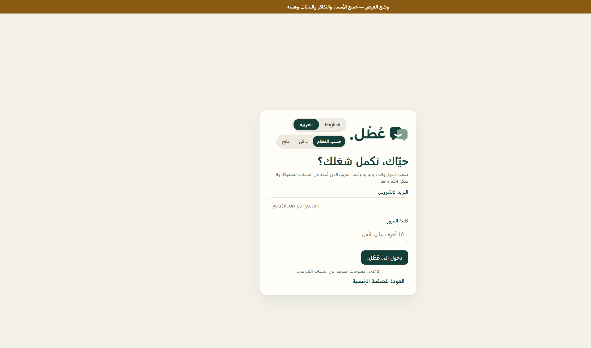
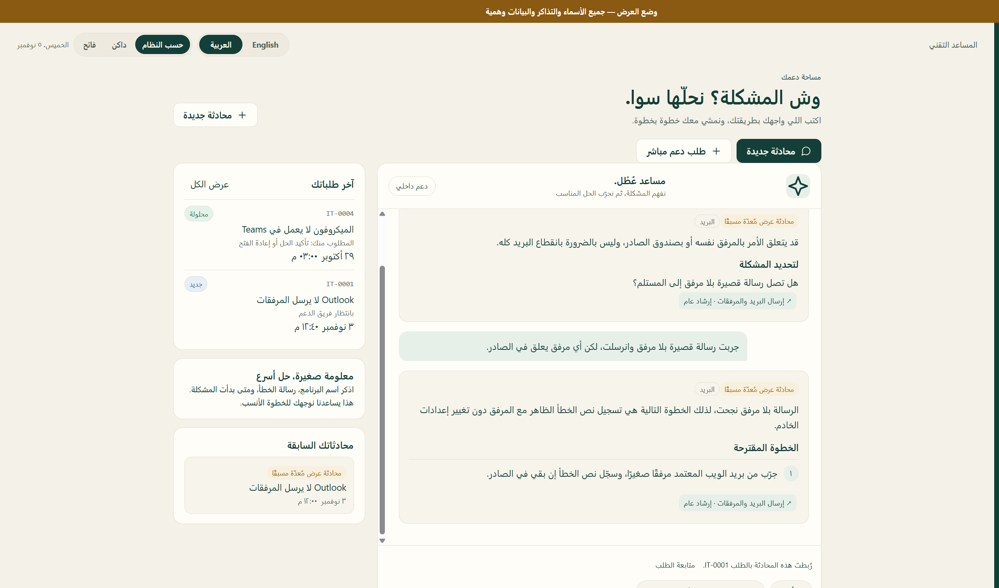
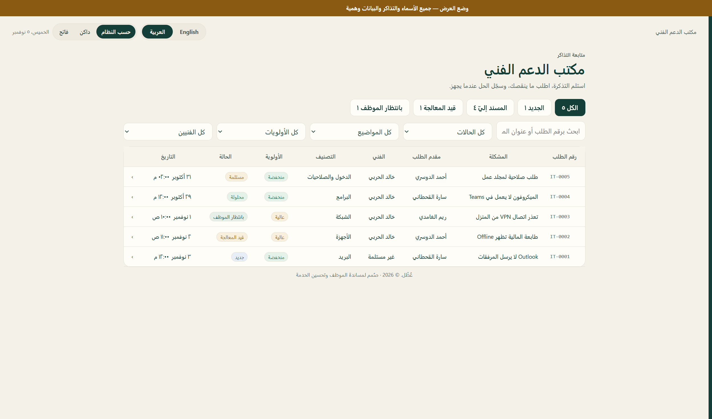
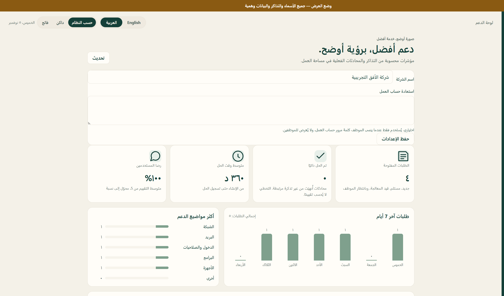

# عُطْل.

مساعد دعم تقني لأعطال العمل. يجمع بين حوار موجّه، واسترجاع من دليل مكتوب، ونموذج عبر Groq مع احتياط OpenRouter، وإدارة تذاكر الدعم.

A workplace IT assistant. It combines a guided conversation, retrieval from a written guide, a model through Groq with an OpenRouter backup, and helpdesk ticket management.

الاستماع الافتراضي على `127.0.0.1` فقط. رفع هذا المستودع إلى GitHub لا يشغّل التطبيق ولا يشغّل النموذج.

The default listener is `127.0.0.1` only. Publishing this repository does not start the application or the model.

## العربية

### المشكلة

عندما يتعطل البريد أو الشبكة أو جهاز العمل، يضيع الوقت بين شرح المشكلة أكثر من مرة وبين انتظار فني لكل عطل بسيط. عُطْل. يعطي الموظف خطوة تالية آمنة من دليل محلي، ويحوّل ما يبقى إلى تذكرة يراها الدعم دون إعادة الشرح من الصفر.

### ماذا يفعل

- **المساعد:** حوار بالعربية أو الإنجليزية عن أعطال تقنية مرتبطة بالعمل. لا يطلب كلمات المرور أو رموز التحقق، ولا ينفّذ إصلاحًا على الجهاز.
- **الاسترجاع ثم التوليد:** يختار الدليل مقالات مرتبطة بالمنتج والسياق، ويرسل مقتطفات قصيرة إلى النموذج. هذا استرجاع نصي مع سياق المحادثة، وليس قاعدة متجهات. إذا لم يوجد مصدر مناسب لا يُختلق رابط أو إعداد.
- **مسارات مراجعة:** بعض الأعطال الشائعة، مثل الشبكة والبريد والدخول والطابعة وحالات موثّقة في Teams وExcel وOneDrive، تسير بخطوات مكتوبة ولا تنتظر النموذج.
- **التذاكر:** الموظف ينشئ طلبًا، والفني يستلمه ويتابعه ويسجّل الحل، والموظف يؤكد أو يعيد الفتح.
- **التشغيل:** Node.js وSQLite على السيرفر. المساعد يتصل بـ Groq، ثم بـ OpenRouter إذا فشل الطلب. لا إرسال بريد.

### الصلاحيات

التحقق يتم في الخادم. المستخدم لا يختار دوره عند الدخول.

| الدور | ما يستطيعه |
| --- | --- |
| موظف | يستخدم المساعد، ينشئ تذكرة، ويرى تذاكره ومحادثاته فقط. يتابع الرد، ويقيّم، ويؤكد الحل أو يعيد الفتح. |
| فني دعم | يرى طابور المكتب، يستلم التذكرة الجديدة، يضيف الرد والحل. لا يرى لوحة المؤشرات ولا يعدّل الدليل ولا يعيد الإسناد. |
| مسؤول | يدير التذاكر والدليل والمستخدمين، ويرى مؤشرات محسوبة من السجلات، ويعيد الإسناد. |

إذا كانت قاعدة البيانات فارغة تظهر مرة واحدة شاشة إنشاء أول مسؤول، ويختار هو كلمة المرور. لا توجد كلمة مرور إدارة ثابتة في التشغيل الأساسي. بعد ذلك يُغلق التسجيل العام، ويضيف المسؤول الحسابات بدعوة تُستخدم مرة واحدة.

### التقنيات

- Node.js 24 أو أحدث، بوحدات `node:http` و`node:sqlite` و`node:crypto` المدمجة.
- لا اعتمادات npm، لذلك لا يلزم `npm install`.
- واجهة HTML وCSS وJavaScript بلا إطار أمامي.
- SQLite في ملف ينشأ عند أول تشغيل.
- Groq بالنموذج `openai/gpt-oss-120b`. إذا تعذر الطلب يُستخدم OpenRouter بالنموذج `meta-llama/llama-4-maverick`.

### التشغيل

يلزم Node.js 24 أو أحدث، وسيرفر يبقى شغالًا، ومفتاح Groq. مفتاح OpenRouter احتياط. المفاتيح توضع في `.env` ولا تُرفع إلى GitHub.

```powershell
git clone https://github.com/MohammedMujib/atal-ai-support.git
cd atal-ai-support
copy .env.example .env
npm start
```

ثم افتح http://127.0.0.1:3002

في أول زيارة أنشئ حساب المسؤول. تُنشأ `data/atal.db` تلقائيًا إذا لم تكن موجودة. هذه القاعدة محلية ولا تأتي مع المستودع.

على Windows يمكن أيضًا تشغيل `start.cmd`. إذا كان المنفذ مشغولًا:

```powershell
$env:PORT = "3003"
npm start
```

املأ `GROQ_API_KEY` في `.env` قبل التشغيل. `start-local.mjs` و`demo-server.mjs` يقرآن هذا الملف. الافتراضيات: المنفذ `3002` والعنوان `127.0.0.1`.

```powershell
npm run check
npm test
```

الاختبارات تتحقق من الحوار والصلاحيات والاسترجاع وعقد الرد. نجاحها لا يعني أن النموذج أجاب بشكل صحيح على كل سؤال.

### وضع العرض

وضع منفصل ببيانات وهمية لشركة اسمها **شركة الأفق التجريبية**. لا يكتب في قاعدة التشغيل الأساسي، ولا يعمل مع `npm start`.

```powershell
npm run demo
```

ثم افتح http://127.0.0.1:3020

كلمة المرور لهذه الحسابات الوهمية فقط: `AtalDemo2026!`

| الاسم | الدور | البريد |
| --- | --- | --- |
| نورة العتيبي | مسؤولة | admin@atal-demo.test |
| خالد الحربي | فني دعم | support@atal-demo.test |
| سارة القحطاني | موظفة | sara@atal-demo.test |
| أحمد الدوسري | موظف | ahmad@atal-demo.test |
| ريم الغامدي | موظفة | reem@atal-demo.test |

بطاقات الدخول السريع في هذه الصفحة فقط تفتح جلسة فعلية للحسابات الوهمية. لإعادة العينات، أوقف وضع العرض ثم نفّذ `npm run demo:reset`. الأمر يرفض أي مسار خارج `data/demo`.

### صور الواجهة

الصور من وضع العرض ببيانات وهمية.









### حدود هذه النسخة

- لا يحل كل الأعطال، ولا ضمان لصحة الإجابات بنسبة 100%. راجع الخطوة قبل تنفيذها، ولا تشارك كلمة مرور أو رمز تحقق.
- من 159 موضوعًا محفوظًا، 13 فقط بمصدر محدد ومعتمدة للاسترجاع: 11 من Microsoft Support، وواحد من MDN Web Docs، وواحد من دليل سلامة بطارية Dell. البقية، وعددها 146، موسومة «يحتاج مراجعة» لأنها بلا صفحة إجراء محددة، ولا تُرسل إلى النموذج ولا تُعرض كإرشاد معتمد.
- النصوص ملخصات أصلية لإرشادات عامة، وليست إجراءات شركة بعينها. حقل استعادة حساب العمل عند المسؤول فارغ في الأصل.
- إذا غاب مفتاح Groq وفشل OpenRouter، يتعذر رد المساعد في المسارات التي تعتمد على النموذج. تبقى إمكانية إنشاء تذكرة.
- الاستماع الافتراضي محلي. هذه النسخة ليست خدمة مستضافة، ولا ترسل بريدًا أو إشعارًا خارج الجهاز.
- لم يُختبر حد بعينه لعدد المستخدمين المتزامنين.

### الحقوق والمصادر

جميع الحقوق محفوظة. هذا المستودع لا يمنح رخصة استخدام أو نسخ أو تعديل أو إعادة توزيع.

ملاحظات المصادر والأصول:

- مقالات الدليل الملخّصة تشير إلى صفحات عامة من Microsoft Support وApple Support وGoogle Chrome Help وZoom Support وMDN Web Docs ودليل Dell لسلامة البطارية. الروابط محفوظة مع المقالات. النص ليس نقلًا حرفيًا لتلك الصفحات، وحقوقها تبقى لأصحابها.
- الواجهة تستخدم خطوط الجهاز: Segoe UI وTahoma وNoto Naskh Arabic وArial. لا توجد ملفات خطوط مضمّنة.
- صور الشعار في `public/` جزء من المشروع. `brand-word-light-original.png` و`brand-word-dark-original.png` أصل محفوظ وغير معروض. `atal-logo-approved.png` لم يُعدَّل.
- لا مكتبات npm طرف ثالث في هذه النسخة.

## English

### The problem

When mail, the network, or a work device fails, time goes into explaining the same problem more than once and waiting for a technician for every small fault. عُطْل. gives the employee a safe next step from a local guide, and turns what remains into a ticket support can see without starting the explanation over.

### What it does

- **Assistant:** an Arabic or English conversation about workplace IT faults. It does not ask for passwords or verification codes, and it does not repair the device itself.
- **Retrieve, then generate:** the guide selects articles that match the product and the conversation, and sends short excerpts to the model. Ranking is textual and contextual, not a vector database. If nothing matches, it does not invent a link or a setting.
- **Reviewed paths:** some common faults, including network, mail, sign-in, printing, and documented Teams, Excel, and OneDrive cases, follow written steps and do not wait for the model.
- **Tickets:** an employee opens a request, a technician accepts it and records the fix, and the employee confirms or reopens it.
- **Runtime:** Node.js and SQLite on the server. The assistant calls Groq, then OpenRouter if that request fails. It does not send mail.

### Permissions

Authorization is enforced on the server. A person does not choose a role on the sign-in form.

| Role | Access |
| --- | --- |
| Employee | Uses the assistant, creates a ticket, and sees only their own tickets and conversations. Follows replies, rates the service, and confirms or reopens a fix. |
| Technician | Sees the support queue, accepts a new ticket, and adds the reply and the solution. Does not see the dashboard, edit the guide, or reassign tickets. |
| Administrator | Manages tickets, the guide, and users, sees figures calculated from records, and can reassign a ticket. |

An empty database shows a one-time screen to create the first administrator, who chooses the password. Basic mode has no built-in administrator password. Public registration then closes, and the administrator adds accounts with a one-time invitation.

### Stack

- Node.js 24 or newer, using the built-in `node:http`, `node:sqlite`, and `node:crypto` modules.
- No npm dependencies, so `npm install` is not required.
- HTML, CSS, and JavaScript without a frontend framework.
- A SQLite file created on first launch.
- Groq with `openai/gpt-oss-120b`. If that request fails, OpenRouter is used with `meta-llama/llama-4-maverick`.

### Run it

You need Node.js 24 or newer, a server that stays running, and a Groq key. An OpenRouter key is the backup. Put the keys in `.env` and do not commit that file.

```powershell
git clone https://github.com/MohammedMujib/atal-ai-support.git
cd atal-ai-support
copy .env.example .env
npm start
```

Open http://127.0.0.1:3002

On the first visit, create the administrator account. `data/atal.db` is created when it is missing. That database is local and is not in the repository.

On Windows you can also run `start.cmd`. If the port is busy:

```powershell
$env:PORT = "3003"
npm start
```

Fill in `GROQ_API_KEY` in `.env` before starting. `start-local.mjs` and `demo-server.mjs` load that file. Defaults are port `3002` and host `127.0.0.1`.

```powershell
npm run check
npm test
```

The tests cover conversation flow, permissions, retrieval, and the reply contract. A passing run does not prove that the model answered every question correctly.

### Demo mode

A separate mode with fictional data for **شركة الأفق التجريبية** (Al-Ufuq Experimental Company). It does not write to the primary database, and it does not start with `npm start`.

```powershell
npm run demo
```

Open http://127.0.0.1:3020

Password for these fictional accounts only: `AtalDemo2026!`

| Name | Role | Email |
| --- | --- | --- |
| نورة العتيبي | Administrator | admin@atal-demo.test |
| خالد الحربي | Technician | support@atal-demo.test |
| سارة القحطاني | Employee | sara@atal-demo.test |
| أحمد الدوسري | Employee | ahmad@atal-demo.test |
| ريم الغامدي | Employee | reem@atal-demo.test |

Quick sign-in cards on that page open a real server session for the fictional accounts. To restore the samples, stop demo mode and run `npm run demo:reset`. The command refuses any path outside `data/demo`.

### Interface

The images above are from demo mode and use fictional data: the sign-in screen, the assistant with a prepared mail conversation, the support desk, and the administrator dashboard.

### Limits of this version

- It does not solve every fault, and answers are not guaranteed to be correct. Review a step before acting on it, and do not share a password or verification code.
- Of 159 stored topics, 13 have a specific source and are eligible for retrieval: 11 from Microsoft Support, one from MDN Web Docs, and one from a Dell battery-safety guide. The other 146 are marked “needs review” because they do not cite a specific procedure page. They are not sent to the model and are not shown as approved guidance.
- The text is an original summary of general public guidance, not one company’s procedure. The administrator’s work-account recovery field is empty by default.
- If the Groq key is missing and OpenRouter also fails, assistant replies that depend on the model are unavailable. Creating a ticket still works.
- The default bind address is local. This version is not a hosted service, and it does not send mail or notifications off the machine.
- No specific concurrent-user capacity has been tested.

### Rights and sources

All rights reserved. This repository does not grant a license to use, copy, modify, or redistribute the project.

Source and asset notes:

- Summarized guide topics point at public pages from Microsoft Support, Apple Support, Google Chrome Help, Zoom Support, MDN Web Docs, and a Dell battery-safety guide. URLs are stored with the topics. The text is not a verbatim copy of those pages, and their rights remain with their owners.
- The interface uses system fonts: Segoe UI, Tahoma, Noto Naskh Arabic, and Arial. No font files are bundled.
- Logo images in `public/` belong to the project. `brand-word-light-original.png` and `brand-word-dark-original.png` are preserved originals and are not shown in the interface. `atal-logo-approved.png` is unchanged.
- This version has no third-party npm packages.
